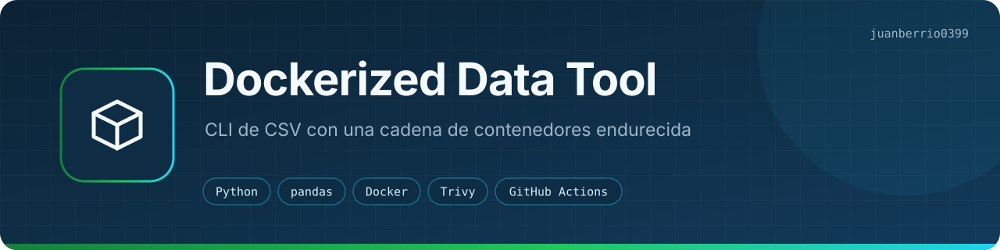

<p align="center"></p>
<p align="center"><a href="README.md">English</a> · <b>Español</b></p>
<p><b>Qué hace:</b> una CLI que lee un CSV e imprime su tamaño, sus columnas y un resumen numérico. También puede validar el archivo contra un contrato de esquema y, si se lo pides, hacer que Gemini explique los números.</p>
<p><b>Cómo funciona:</b> <code>app.py</code> hace el trabajo con pandas y pandera; GitHub Actions construye la imagen de forma nativa para amd64 y arm64, la escanea con Trivy y solo sube a GHCR el digest exacto que pasó, con SBOM y procedencia SLSA.</p>
<p><a href="https://github.com/juanberrio0399/dockerized-data-tool/actions/workflows/tests.yml"></a> <a href="https://github.com/juanberrio0399/dockerized-data-tool/actions/workflows/publish.yml"></a>   <a href="LICENSE"></a></p>

---

## Por qué existe

La parte de pandas son diez líneas. Armé el repo alrededor de todo lo demás, porque eso es lo que se rompe en un pipeline de verdad.

Una entrada mala nunca termina en un traceback: sale una sola línea `Error: …` por stderr y un código de salida con el que un script puede decidir qué hacer. Un contrato con `--schema` atrapa las fallas silenciosas que sí duelen, como una columna renombrada, texto en una columna numérica o valores obligatorios que llegan vacíos, antes de que algo más abajo lea el archivo.

Y se distribuye como contenedor, no con `pip install`. La imagen corre con un UID sin privilegios, lleva SBOM y procedencia SLSA, y solo llega al registro después de que un escaneo de vulnerabilidades pasa sobre exactamente los bits que se publican. Esa cadena es el punto del repo.

## Cómo funciona

```mermaid
flowchart TD
    subgraph cli["Al correr la herramienta"]
        C1["app.py ARCHIVO"] --> C2{"¿se puede leer la ruta?"}
        C2 -->|"no existe, es carpeta,<br/>sin permiso"| E2["sale con 2"]
        C2 -->|"sí"| C3{"¿pandas lo entiende?"}
        C3 -->|"vacío o mal formado"| E1["sale con 1"]
        C3 -->|"sí"| C4{"¿qué opción?"}
        C4 -->|"--infer-schema ARCHIVO"| C5["escribe el contrato YAML:<br/>columnas, tipos, vacíos"] --> E0a["sale con 0"]
        C4 -->|"--schema ARCHIVO"| C6{"valida con pandera,<br/>lazy"}
        C6 -->|"falla"| E3["una línea por problema,<br/>sale con 3"]
        C6 -->|"pasa"| C7
        C4 -->|"ninguna"| C7["imprime filas, columnas<br/>y describe numérico"]
        C7 --> C8{"--insights"}
        C8 -->|"no"| E0b["sale con 0, sin red"]
        C8 -->|"sí"| C9["manda solo estadísticas agregadas<br/>a Gemini, 30 s, un reintento"]
        C9 -->|"sin key o falla la API"| E4["sale con 4,<br/>el resumen ya salió"]
        C9 -->|"ok"| E0c["imprime la explicación, sale con 0"]
    end

    subgraph ci["Publicación, por plataforma, en runners nativos"]
        P1["build en ubuntu-24.04<br/>y ubuntu-24.04-arm"] --> P2["Trivy: CRITICAL y HIGH<br/>con arreglo disponible"]
        P2 -->|"cualquier hallazgo"| P3["falla el job, no se publica nada"]
        P2 -->|"limpio"| P4["SBOM SPDX + prueba de humo:<br/>corre y el UID no es 0"]
        P4 --> P5["sube la imagen escaneada,<br/>verifica digest subido = escaneado"]
        P5 --> P6["atestigua procedencia SLSA<br/>y SBOM por digest"]
        P6 --> P7["imagetools create: manifest list<br/>con los dos digests escaneados"]
        P7 --> P8["verifica que el índice tenga justo<br/>esos dos digests, uno por plataforma"]
        P8 --> P9["atestigua la procedencia del índice"]
    end
```



Entre el escaneo y la subida no se reconstruye nada, y el workflow falla si el digest que vuelve a bajar no es igual a la imagen que revisó Trivy. Lo que descargas es, byte por byte, lo que se escaneó y se probó.

Las dos plataformas compilan en runners nativos (el `ubuntu-24.04-arm` gratis de GitHub para arm64), así que no hay emulación con QEMU y la prueba de humo de arm64 corre en hardware arm64 de verdad.

| Situación | Código de salida |
|---|---|
| Resumen impreso o esquema escrito (incluye un archivo con solo encabezados o sin columnas numéricas) | `0` |
| El archivo está vacío o no se puede leer como CSV; también un YAML de `--schema` ilegible | `1` |
| La ruta no existe, es una carpeta o no se puede leer; también un archivo de `--schema` que no existe o un destino de `--infer-schema` sin permiso de escritura | `2` |
| El CSV no cumple el contrato pasado con `--schema` | `3` |
| `--insights` no pudo correr (no hay `GEMINI_API_KEY` o falló la API). El resumen ya se imprimió | `4` |

Cómo funcionan los contratos, qué manda exactamente `--insights` a Google, los tags de la imagen, las decisiones de diseño y la guía de operación: **[docs/reference.es.md](docs/reference.es.md)**.

Historias de usuario, flujos y datos: [docs/PRODUCTO.md](docs/PRODUCTO.md).

## Con qué se conecta

| Repo o sistema | Cómo |
|---|---|
| [juanberrio0399.github.io](https://github.com/juanberrio0399/juanberrio0399.github.io) | Mi sitio de portafolio tiene su tarjeta de proyecto |
| GitHub Container Registry | Donde se publica la imagen: `ghcr.io/juanberrio0399/dockerized-data-tool` |
| API de Google Gemini (opcional) | Solo con `--insights`, y solo estadísticas agregadas |
| Trivy, CodeQL, Dependabot | Bloqueo por vulnerabilidades en la imagen, SAST sobre el Python, actualizaciones semanales agrupadas |

## Cómo correrlo

Baja la imagen publicada, sin clonar ni compilar:

```bash
docker pull ghcr.io/juanberrio0399/dockerized-data-tool:latest
docker run --rm ghcr.io/juanberrio0399/dockerized-data-tool:latest          # usa el sample.csv incluido
docker run --rm -v "$PWD:/data" ghcr.io/juanberrio0399/dockerized-data-tool:latest \
  python app.py /data/tu_archivo.csv
```

El contenedor corre con UID `10001`, así que la carpeta montada tiene que poder leerla ese usuario.

Contrato de esquema e insights con IA:

```bash
python app.py sample.csv --infer-schema schema.yaml   # escribe el contrato a partir de un archivo bueno
python app.py new_export.csv --schema schema.yaml     # valida contra él los archivos que lleguen después
GEMINI_API_KEY=... python app.py sample.csv --insights
```

Compilarla tú mismo, o correrla sin Docker:

```bash
docker build -t data-tool .
docker run --rm -v "$PWD:/data" data-tool python app.py /data/tu_archivo.csv

pip install -r requirements.txt
python app.py sample.csv
```

Desarrollo, los mismos comandos que corre el CI:

```bash
pip install -r requirements-dev.txt
pytest -q                               # 41 pruebas; la llamada a Gemini siempre va simulada
ruff check . && ruff format --check .
```

La única variable de entorno es `GEMINI_API_KEY`, y solo la necesita `--insights`. No hay credenciales del registro en ninguna parte: `publish.yml` entra a GHCR con el `GITHUB_TOKEN` del propio workflow.

## Estructura

| Ruta | Qué hay |
|---|---|
| `app.py` | Toda la herramienta: lectura del CSV, resumen, contratos de pandera, la llamada a Gemini y la CLI |
| `sample.csv` | Cinco filas de ejemplo, incluidas en la imagen como argumento por defecto |
| `requirements.txt` | Dependencias de ejecución (pandas, pandera, pyyaml, requests) |
| `requirements-dev.txt` | Lo anterior más pytest y un Ruff con versión fija |
| `pyproject.toml` | Solo la configuración de Ruff; la herramienta se corre con `python app.py`, no es un paquete instalable |
| `Dockerfile` | Build en dos etapas sobre `python:3.14-slim`: dependencias en un venv y luego una imagen final con parches de seguridad, sin pip/setuptools y con usuario sin root |
| `.dockerignore` | Deja el historial, las pruebas y los archivos locales fuera del contexto de build |
| `tests/` | `test_app.py` (códigos de salida, stderr, argumentos), `test_schema.py` (contratos y mensajes de error), `test_insights.py` (Gemini con HTTP simulado) |
| `.github/workflows/` | `tests.yml` (Ruff, pytest, build de la imagen, Trivy, revisiones de no-root), `publish.yml` (la publicación del diagrama), `codeql.yml` (SAST) |
| `docs/` | Referencia (contratos, insights, tags, decisiones, operación), documento de producto (historias, flujos, datos) y los banners |

## Estado

Mantenido. La imagen está en GHCR, la última versión es `v1.0.0` y cada push a `main` publica `:edge`. La CLI, los contratos, la ruta opcional de Gemini y la publicación funcionan, con 41 pruebas que nunca tocan la red.

Huecos que conozco: no hay un `schema.yaml` de ejemplo en el repo, `GEMINI_MODEL` es una constante en `app.py` que va a fallar con código `4` cuando Google retire el modelo, y no hay CHANGELOG. Lo siguiente, de los issues abiertos: [#47 OpenSSF Scorecard](https://github.com/juanberrio0399/dockerized-data-tool/issues/47), [#55 firma sin llaves con Cosign](https://github.com/juanberrio0399/dockerized-data-tool/issues/55) y [#56 validación por lotes para archivos más grandes que la memoria](https://github.com/juanberrio0399/dockerized-data-tool/issues/56). Más en [PLAN.md](PLAN.md) (en inglés).

## Mantenimiento

Las dependencias las mantiene al día Dependabot, que configuré yo en [`.github/dependabot.yml`](.github/dependabot.yml). Cada PR que abre me lo asigna a mí con la etiqueta `mantenimiento-automatico`, solo entra si pasan las pruebas y los cambios de versión mayor los reviso a mano.

## Licencia

[MIT](LICENSE) · Juan Berrio · [juanberrio0399.github.io](https://juanberrio0399.github.io)
