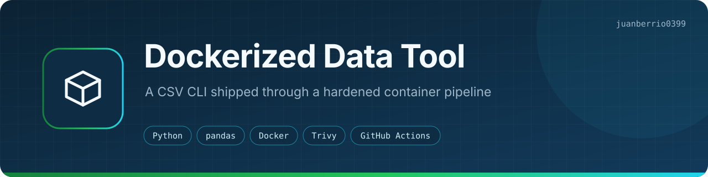

<p align="center"></p>
<p align="center"><b>English</b> · <a href="README.es.md">Español</a></p>
<p><b>What it does:</b> a CLI that reads a CSV and prints its shape, columns and numeric summary. It can also check the file against a schema contract and, if you ask, have Gemini explain the numbers.</p>
<p><b>How it works:</b> <code>app.py</code> does the work with pandas and pandera; GitHub Actions builds the image natively for amd64 and arm64, scans it with Trivy, and only pushes to GHCR the exact digest that passed, with SBOM and SLSA provenance.</p>
<p><a href="https://github.com/juanberrio0399/dockerized-data-tool/actions/workflows/tests.yml"></a> <a href="https://github.com/juanberrio0399/dockerized-data-tool/actions/workflows/publish.yml"></a>   <a href="LICENSE"></a></p>

---

## Why it exists

The pandas part is ten lines. I built the repo around everything else, because that's what breaks in real pipelines.

Bad input never ends in a traceback: you get one `Error: …` line on stderr and an exit code a script can branch on. A `--schema` contract catches the quiet breakages that actually hurt, like a renamed column, text in a numeric column or required values gone empty, before anything downstream reads the file.

And it ships as a container, not a `pip install`. The image runs as an unprivileged UID, carries an SBOM and SLSA provenance, and only reaches the registry after a vulnerability scan passes on the exact bits that get pushed. That chain is the point of the repo.

## How it works

```mermaid
flowchart TD
    subgraph cli["Running the tool"]
        C1["app.py FILE"] --> C2{"path readable"}
        C2 -->|"missing, a directory,<br/>no permission"| E2["exit 2"]
        C2 -->|"yes"| C3{"pandas can parse it"}
        C3 -->|"empty or malformed"| E1["exit 1"]
        C3 -->|"yes"| C4{"which flag"}
        C4 -->|"--infer-schema FILE"| C5["write the YAML contract:<br/>columns, dtypes, nullability"] --> E0a["exit 0"]
        C4 -->|"--schema FILE"| C6{"pandera validate,<br/>lazy"}
        C6 -->|"fails"| E3["one line per problem,<br/>exit 3"]
        C6 -->|"passes"| C7
        C4 -->|"neither"| C7["print rows, columns<br/>and numeric describe"]
        C7 --> C8{"--insights"}
        C8 -->|"no"| E0b["exit 0, no network call"]
        C8 -->|"yes"| C9["send aggregate stats only<br/>to Gemini, 30s, one retry"]
        C9 -->|"key missing or API fails"| E4["exit 4,<br/>summary already printed"]
        C9 -->|"ok"| E0c["print explanation, exit 0"]
    end

    subgraph ci["Release, per platform, on native runners"]
        P1["build on ubuntu-24.04<br/>and ubuntu-24.04-arm"] --> P2["Trivy: CRITICAL and HIGH<br/>with a fix available"]
        P2 -->|"any finding"| P3["job fails, nothing published"]
        P2 -->|"clean"| P4["SPDX SBOM + smoke test:<br/>runs, and UID is not 0"]
        P4 --> P5["push the scanned image,<br/>assert pushed digest = scanned image"]
        P5 --> P6["attest SLSA provenance<br/>and SBOM per digest"]
        P6 --> P7["imagetools create: manifest list<br/>from the two scanned digests"]
        P7 --> P8["assert the index holds exactly<br/>those two digests, one per platform"]
        P8 --> P9["attest provenance of the index"]
    end
```



Nothing gets rebuilt between the scan and the push, and the workflow fails unless the digest it pulls back equals the image Trivy looked at. What you pull is byte for byte what was scanned and smoke tested.

Both platforms build on native runners (GitHub's free `ubuntu-24.04-arm` for arm64), so there's no QEMU emulation and the arm64 smoke test runs on real arm64 hardware.

| Situation | Exit code |
|---|---|
| Summary printed or schema written (including a header-only file or one with no numeric columns) | `0` |
| The file is empty or isn't parseable as CSV; also an unreadable `--schema` YAML | `1` |
| The path doesn't exist, is a directory or can't be read; also a missing `--schema` file or an unwritable `--infer-schema` target | `2` |
| The CSV doesn't match the contract passed with `--schema` | `3` |
| `--insights` couldn't run (no `GEMINI_API_KEY`, or the API failed). The summary was already printed | `4` |

How the schema contracts work, exactly what `--insights` sends to Google, the image tags, the design decisions and the runbook: **[docs/reference.md](docs/reference.md)**.

User stories, flows and data: [docs/PRODUCT.md](docs/PRODUCT.md).

## What it connects to

| Repo or system | How |
|---|---|
| [juanberrio0399.github.io](https://github.com/juanberrio0399/juanberrio0399.github.io) | My portfolio site has a project card for it |
| GitHub Container Registry | Where the image is published: `ghcr.io/juanberrio0399/dockerized-data-tool` |
| Google Gemini API (optional) | Only with `--insights`, and only aggregate statistics |
| Trivy, CodeQL, Dependabot | Vulnerability gate on the image, SAST on the Python, weekly grouped updates |

## How to run it

Pull the published image, no clone and no build:

```bash
docker pull ghcr.io/juanberrio0399/dockerized-data-tool:latest
docker run --rm ghcr.io/juanberrio0399/dockerized-data-tool:latest          # built-in sample.csv
docker run --rm -v "$PWD:/data" ghcr.io/juanberrio0399/dockerized-data-tool:latest \
  python app.py /data/your.csv
```

The container runs as UID `10001`, so a mounted folder has to be readable by that user.

Schema contract and AI insights:

```bash
python app.py sample.csv --infer-schema schema.yaml   # write the contract from a known-good file
python app.py new_export.csv --schema schema.yaml     # validate later files against it
GEMINI_API_KEY=... python app.py sample.csv --insights
```

Build it yourself, or run it without Docker:

```bash
docker build -t data-tool .
docker run --rm -v "$PWD:/data" data-tool python app.py /data/your.csv

pip install -r requirements.txt
python app.py sample.csv
```

Development, the same commands CI runs:

```bash
pip install -r requirements-dev.txt
pytest -q                               # 41 tests; the Gemini call is always mocked
ruff check . && ruff format --check .
```

The only environment variable is `GEMINI_API_KEY`, and only `--insights` needs it. There are no registry credentials anywhere: `publish.yml` logs in to GHCR with the workflow's own `GITHUB_TOKEN`.

## Structure

| Path | What's there |
|---|---|
| `app.py` | The whole tool: CSV reading, summary, pandera contracts, the Gemini call and the CLI |
| `sample.csv` | Five rows of sample data, baked into the image as the default argument |
| `requirements.txt` | Runtime dependencies (pandas, pandera, pyyaml, requests) |
| `requirements-dev.txt` | The above plus pytest and a pinned Ruff |
| `pyproject.toml` | Ruff configuration only; the tool runs as `python app.py`, it isn't an installable package |
| `Dockerfile` | Two-stage build on `python:3.14-slim`: dependencies into a venv, then a runtime image with security updates, no pip/setuptools and a non-root user |
| `.dockerignore` | Keeps history, tests and local files out of the build context |
| `tests/` | `test_app.py` (exit codes, stderr, arguments), `test_schema.py` (contracts and error messages), `test_insights.py` (Gemini path, HTTP mocked) |
| `.github/workflows/` | `tests.yml` (Ruff, pytest, image build, Trivy, non-root checks), `publish.yml` (the release pipeline above), `codeql.yml` (SAST) |
| `docs/` | Reference (contracts, insights, tags, decisions, operation), product doc (user stories, flows, data) and the banners |

## Status

Maintained. The image is on GHCR, the latest release is `v1.0.0`, and every push to `main` publishes `:edge`. The CLI, contracts, the opt-in Gemini path and the release pipeline all work, with 41 tests that never touch the network.

Gaps I know about: there's no example `schema.yaml` in the repo, `GEMINI_MODEL` is a constant in `app.py` that will fail with exit `4` when Google retires the model, and there's no CHANGELOG. Next, from the open issues: [#47 OpenSSF Scorecard](https://github.com/juanberrio0399/dockerized-data-tool/issues/47), [#55 keyless signing with Cosign](https://github.com/juanberrio0399/dockerized-data-tool/issues/55) and [#56 chunked validation for files larger than memory](https://github.com/juanberrio0399/dockerized-data-tool/issues/56). More in [PLAN.md](PLAN.md).

## License

[MIT](LICENSE) · Juan Berrio · [juanberrio0399.github.io](https://juanberrio0399.github.io)
