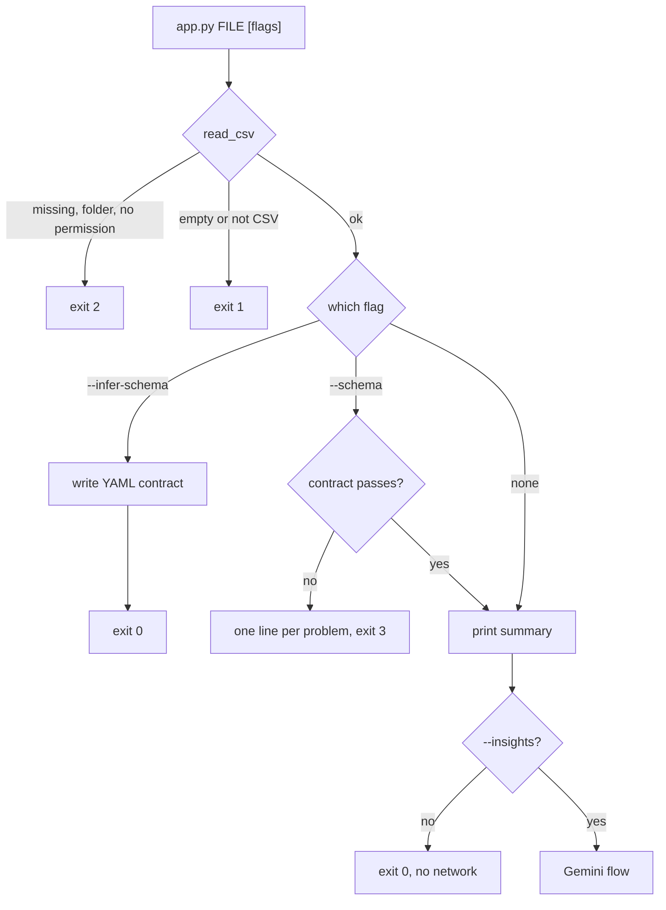
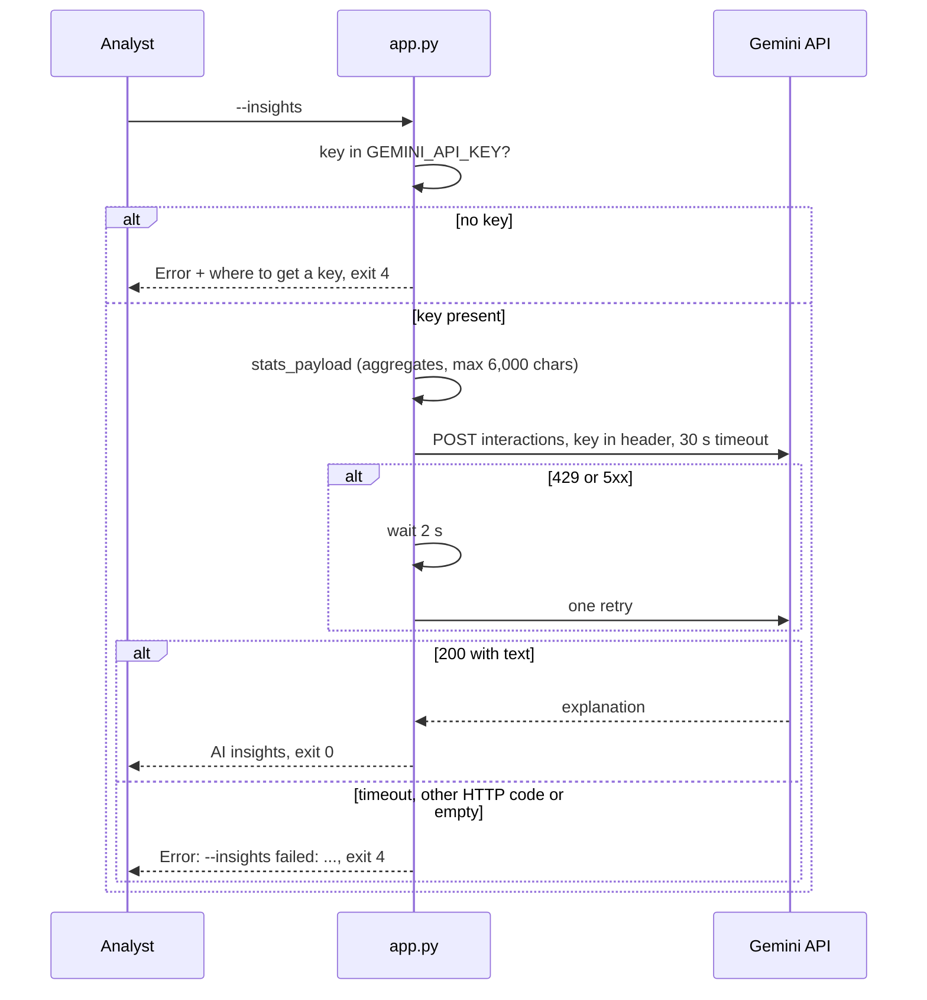
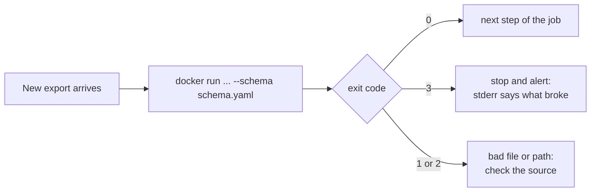
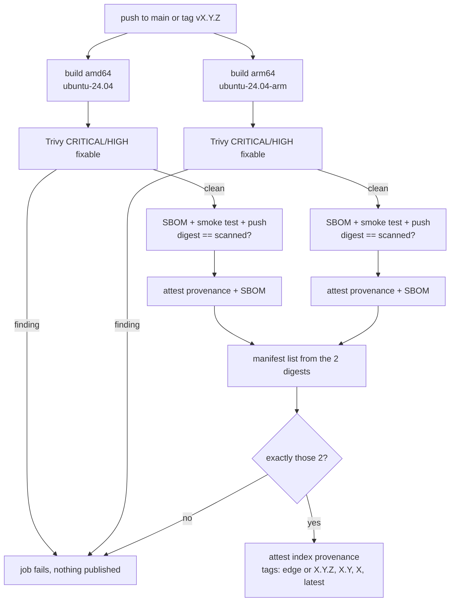
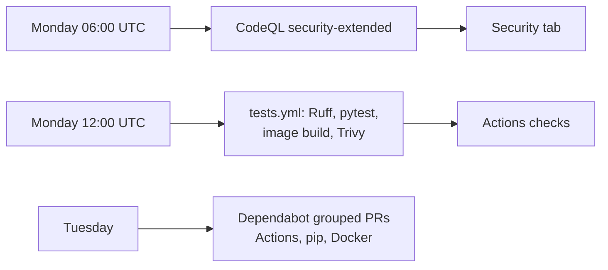

<a href="PRODUCTO.md">Español</a> · <b>English</b>

# Dockerized Data Tool as a product

User stories, flows and data. How each piece is built is in the [README](../README.md) and the [reference](reference.md).

## Who it's for

| Level | Who | What they need |
|---|---|---|
| Day to day | An analyst or data engineer who gets CSV exports | See what's in a file in seconds and catch a broken export before it goes downstream |
| Supervision | The person who owns a pipeline or a scheduled job | Exit codes a script can branch on, so a bad file stops the job instead of polluting a report |
| Management | Doesn't apply directly | There's no dashboard or business report; the closest thing is the security review below |
| Technical | Whoever maintains the image, or a platform/security team that has to approve it | Releases that only publish scanned bits, with SBOM and provenance they can verify |
| External | Google Gemini (only with `--insights`), GitHub Container Registry, and a recruiter reading the repo | Gemini gets aggregates only; GHCR serves the image; the recruiter sees the supply chain working |

## User stories

### Analyst (day to day)

#### HU-01 · Get a quick summary of a CSV
**As** an analyst **I want** to point the tool at a file **so that** I see its size, columns and numbers without opening a notebook.
**Acceptance criteria**
- Given a readable CSV, then the output starts with `File: <path>`, `Rows: <n>  |  Columns: <n>` and the column list, followed by `Numeric summary:` and pandas `describe()` of the numeric columns.
- Given a file with only headers, then it prints "No data rows to summarize." and exits `0`.
- Given no numeric columns, then it prints "No numeric columns to summarize." and exits `0`.
- Given no argument, then it uses the bundled `sample.csv`.
**Where it lives:** `app.py` (`read_csv`, `summarize`)

#### HU-02 · Understand what went wrong without a traceback
**As** an analyst **I want** one clear error line **so that** I know what to fix.
**Acceptance criteria**
- Given a missing path, then `Error: file not found: <path>` on stderr and exit `2`; a folder gives `Error: not a file: <path>`, no permission gives `Error: permission denied: <path>`.
- Given an empty file, then `Error: the file is empty: <path>` and exit `1`; a malformed or binary file gives `Error: could not parse <path> as CSV (...)` and exit `1`.
**Where it lives:** `app.py` (`read_csv`, `fail`), `tests/test_app.py`

#### HU-03 · Write a contract from a file I trust
**As** an analyst **I want** to generate a schema from a known-good export **so that** I don't write it by hand.
**Acceptance criteria**
- Given `--infer-schema schema.yaml`, then the YAML fixes columns, dtypes and nullability and prints `Schema written: schema.yaml (<n> columns)`.
- The min/max ranges pandera infers are not written, so next month's valid data doesn't fail.
- Given a target that can't be written, then `Error: could not write schema ...` and exit `2`.
- `--schema` and `--infer-schema` can't be used together.
**Where it lives:** `app.py` (`write_schema`), `tests/test_schema.py`

#### HU-04 · Get the numbers explained in plain language
**As** an analyst **I want** an optional AI explanation **so that** I can share a first reading with someone who doesn't read statistics.
**Acceptance criteria**
- Given `--insights` and `GEMINI_API_KEY`, then after the summary it prints `AI insights (gemini-3.6-flash) - only the statistics above were sent, never the rows:` and an explanation of at most ~120 words.
- Given `--insights-anonymize`, then column names are sent as `col_1`, `col_2`…; using it without `--insights` is an argument error.
- Given no key, then exit `4` with a message that says where to get a free one, and the summary is already printed.
**Where it lives:** `app.py` (`explain`, `call_gemini`, `stats_payload`), `tests/test_insights.py`

### Pipeline owner (supervision)

#### HU-05 · Stop a job when a file breaks the contract
**As** the owner of a scheduled job **I want** a broken file to stop the run **so that** a renamed column or text in a number column never reaches a report.
**Acceptance criteria**
- Given `--schema schema.yaml` and a file that breaks it, then the summary is not printed, there's one `Error:` line per problem, and the exit code is `3`.
- Messages look like `missing column 'revenue'`, `unexpected column '...'`, `column 'units': expected int64 values, found 'twelve' (line 3)` or `empty values on`, with at most 3 examples and "and N more".
- A cell that failed the type check isn't reported again as a failed range check.
- Given a file that passes, then it prints `Schema: OK (<path>)` and then the summary.
**Where it lives:** `app.py` (`check_schema`, `describe_failures`)

#### HU-06 · Tell problems apart by exit code
**As** the owner of a job **I want** a different code for each kind of failure **so that** the script can decide whether to retry, alert or skip.
**Acceptance criteria**
- `0` ok, `1` the data can't be read, `2` the path is wrong, `3` the contract failed, `4` `--insights` failed after the summary.
- `tests/test_app.py` checks every code, and CI also runs the container against a missing file and fails unless it exits `2`.
**Where it lives:** `app.py` (`EXIT_*`), `.github/workflows/tests.yml`

#### HU-07 · Know that no row leaves the machine
**As** the owner of private data **I want** to be sure what `--insights` sends **so that** I can use it on real files.
**Acceptance criteria**
- Without `--insights` there's no network call at all.
- With it, only row and column counts, column names (unless anonymized), dtypes, empty counts and the numeric `describe()` table are sent, capped at 6,000 characters. Text columns aren't described, so their most frequent value never leaves.
- The key travels only in the `x-goog-api-key` header and is never printed, not even in an error.
**Where it lives:** `app.py` (`stats_payload`, `call_gemini`)

### Maintainer and security review (technical)

#### HU-08 · Run the published image without building anything
**As** a user of the image **I want** to `docker pull` and run it **so that** I get the same tool on any machine.
**Acceptance criteria**
- `ghcr.io/juanberrio0399/dockerized-data-tool` has `linux/amd64` and `linux/arm64` under the same tag.
- The container runs as UID `10001`, not root; CI fails if `id -u` returns `0`.
- `latest`, `1`, `1.0`, `1.0.0` come from Git tags `vX.Y.Z`; `edge` is the latest commit on `main`.
**Where it lives:** `Dockerfile`, `.github/workflows/publish.yml`

#### HU-09 · Publish only what was scanned
**As** the maintainer **I want** the registry to receive exactly the image Trivy checked **so that** nothing unscanned ships.
**Acceptance criteria**
- Each platform builds on a native runner (`ubuntu-24.04`, `ubuntu-24.04-arm`) and Trivy fails the job on any CRITICAL or HIGH finding that has a fix.
- After pushing, the workflow pulls the digest back and fails unless it equals the scanned image.
- The manifest list is built only from the two scanned digests, and the workflow asserts it holds exactly those two.
**Where it lives:** `.github/workflows/publish.yml`

#### HU-10 · Verify where an image came from
**As** a security reviewer **I want** signed provenance and an SBOM **so that** I can approve the image without trusting the README.
**Acceptance criteria**
- Every platform digest has SLSA provenance and an SPDX SBOM attested; the index digest has provenance too.
- `gh attestation verify --owner juanberrio0399 oci://ghcr.io/juanberrio0399/dockerized-data-tool:latest` passes.
- No registry credentials exist: the workflow logs in with its own `GITHUB_TOKEN`.
**Where it lives:** `.github/workflows/publish.yml`

#### HU-11 · Catch new CVEs even when nothing changed
**As** the maintainer **I want** a weekly scan **so that** a new CVE in the base image shows up without waiting for a commit.
**Acceptance criteria**
- `tests.yml` runs every Monday 12:00 UTC and on every push and PR: Ruff, 41 pytest tests, image build, Trivy, the non-root check and the exit-code checks.
- CodeQL runs on every push and PR and Mondays 06:00 UTC; Dependabot opens grouped PRs for Actions, pip and Docker every Tuesday.
**Where it lives:** `.github/workflows/tests.yml`, `.github/workflows/codeql.yml`, `.github/dependabot.yml`

## Flows

### Running the tool

Every failure ends in one `Error:` line on stderr and a known code. The summary is printed before `--insights` runs, so a Gemini failure never hides it.

### AI insights

### Validating a file in a scheduled job

This is how I'd wire it in a pipeline; the tool itself doesn't schedule anything. The point is that each code means one thing, so the job can react without parsing text.

### Release

On a pull request the same build and scan run but nothing is pushed. A `concurrency` group per branch or tag keeps two runs from moving the staging tags at the same time.

### Weekly checks

A red Monday run with no new commits means the base image picked up a CVE. Re-running usually fixes it because the build runs `apt-get upgrade`; if not, the `python:3.14-slim` base has to move.

## Information

| Data | Comes from | Stored in | Read by | Sensitivity | Retention |
|---|---|---|---|---|---|
| The CSV being analysed | The user | Their disk, mounted into the container | `app.py`, in memory only | Whatever the file is (can be personal) | Not kept: nothing is written except `--infer-schema` |
| Schema contract (YAML) | `--infer-schema` or the user | Wherever the user writes it | `--schema` | Internal (column names and types) | As long as the user keeps it |
| Aggregate statistics | `stats_payload` | Sent to Google only with `--insights` | Gemini API | Internal; column names can be hidden with `--insights-anonymize` | Governed by Google's API terms |
| `GEMINI_API_KEY` | The user | Their environment, passed with `-e` | `call_gemini` | Secret | Never stored in the repo or the image |
| Image, SBOM, provenance | `publish.yml` | GHCR and GitHub attestations | Anyone who pulls or verifies | Public | Until the package version is deleted |
| Scan results | Trivy, CodeQL | Actions logs, Security tab | The maintainer | Internal | GitHub's log retention |

## Connections

| System | What for | How | If it goes down |
|---|---|---|---|
| GitHub Actions | Tests, scans, build and release | `tests.yml`, `publish.yml`, `codeql.yml` | No new images; the published ones keep working |
| GitHub Container Registry | Hosts the image | `docker push` with `GITHUB_TOKEN` | `docker pull` fails; building locally still works |
| GitHub attestations (Sigstore) | Provenance and SBOM signatures | `actions/attest-build-provenance`, `actions/attest-sbom` | Release fails before publishing tags |
| Trivy | Vulnerability gate | Action in both workflows | Jobs fail; nothing is published |
| Google Gemini API | Plain-language explanation | HTTPS, `x-goog-api-key` header | `--insights` exits `4`; everything else works |
| Docker Hub (`python:3.14-slim`) | Base image | `FROM` in the `Dockerfile` | Builds fail; published images aren't affected |
| [juanberrio0399.github.io](https://github.com/juanberrio0399/juanberrio0399.github.io) | Links the repo from my portfolio | Project card on the site | Nothing here changes |

## Pending

- OpenSSF Scorecard ([#47](https://github.com/juanberrio0399/dockerized-data-tool/issues/47)).
- Keyless image signing with Cosign ([#55](https://github.com/juanberrio0399/dockerized-data-tool/issues/55)).
- Chunked reading so a file larger than memory doesn't fail ([#56](https://github.com/juanberrio0399/dockerized-data-tool/issues/56)).
- Publish as a GitHub Action on the Marketplace ([#46](https://github.com/juanberrio0399/dockerized-data-tool/issues/46)).
- Other formats (Parquet export with contract metadata, [#75](https://github.com/juanberrio0399/dockerized-data-tool/issues/75)) and drift detection between snapshots ([#76](https://github.com/juanberrio0399/dockerized-data-tool/issues/76)).
- An example `schema.yaml` in the repo and a CHANGELOG.
- An early warning when Google retires `GEMINI_MODEL`: today it only shows up as an exit `4` at runtime.
