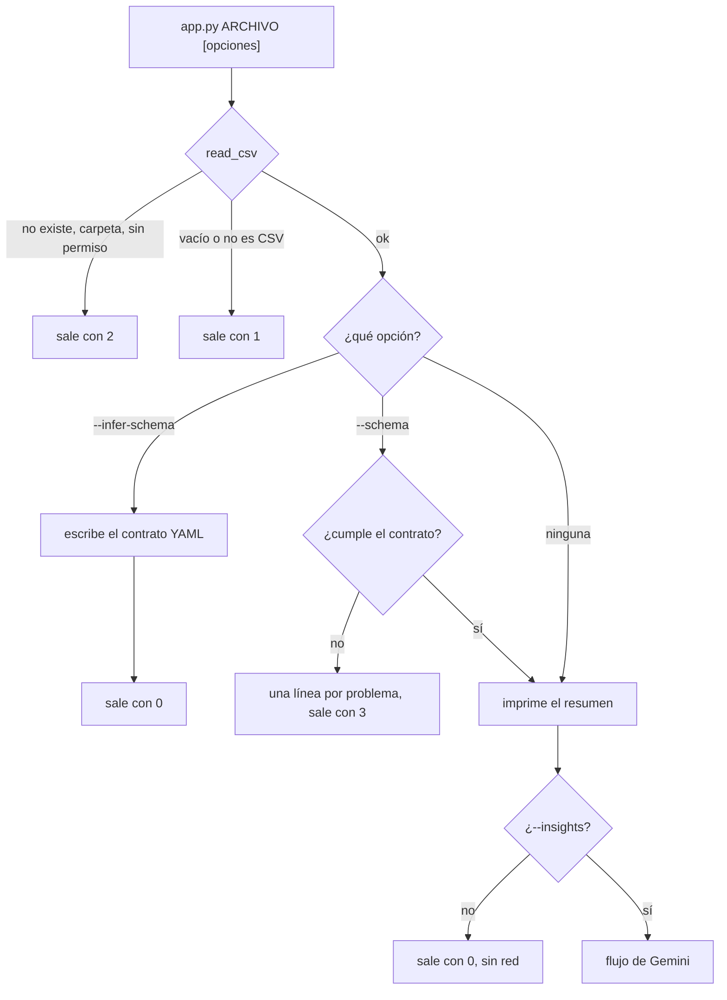
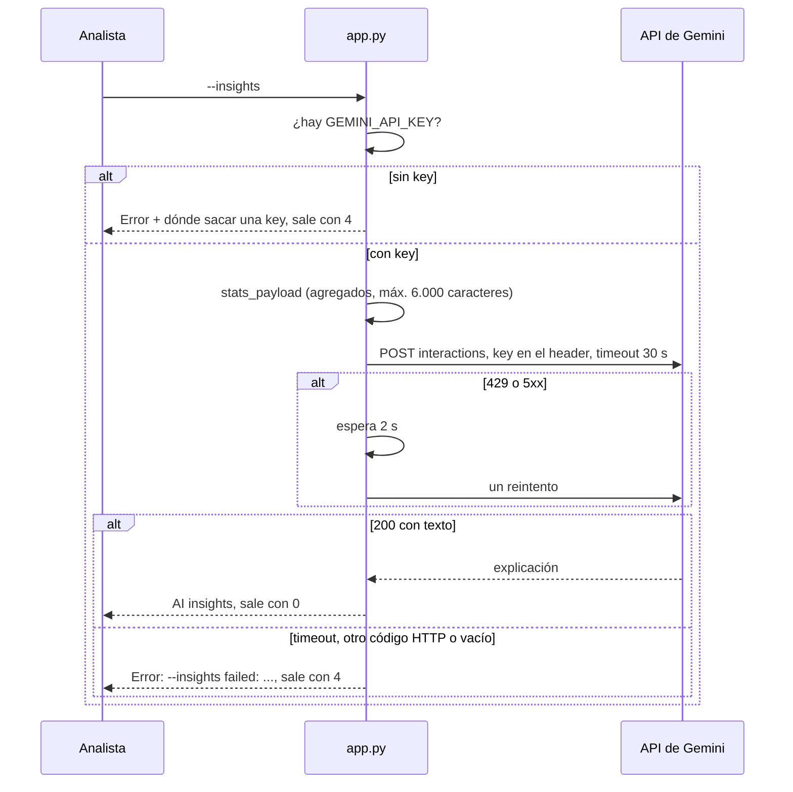
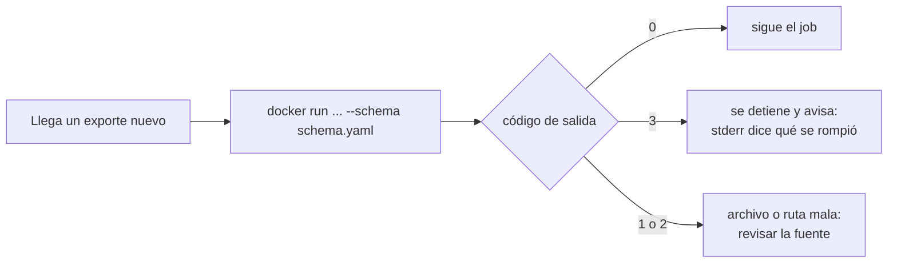
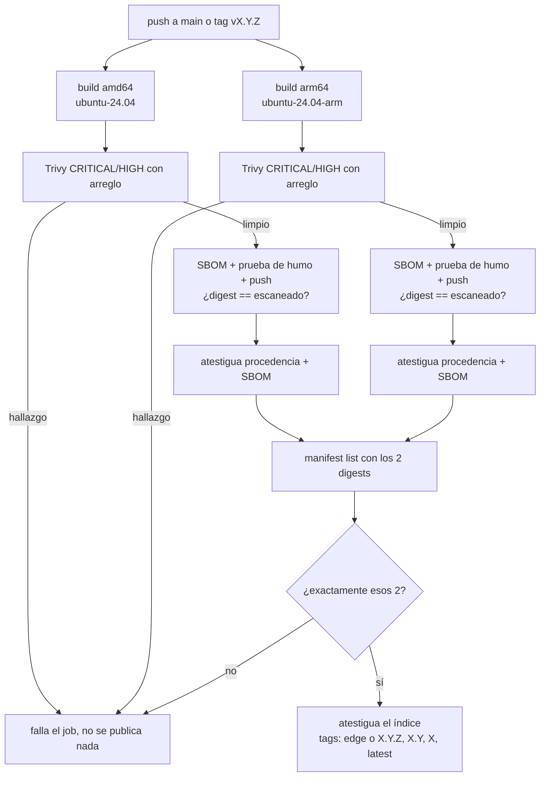
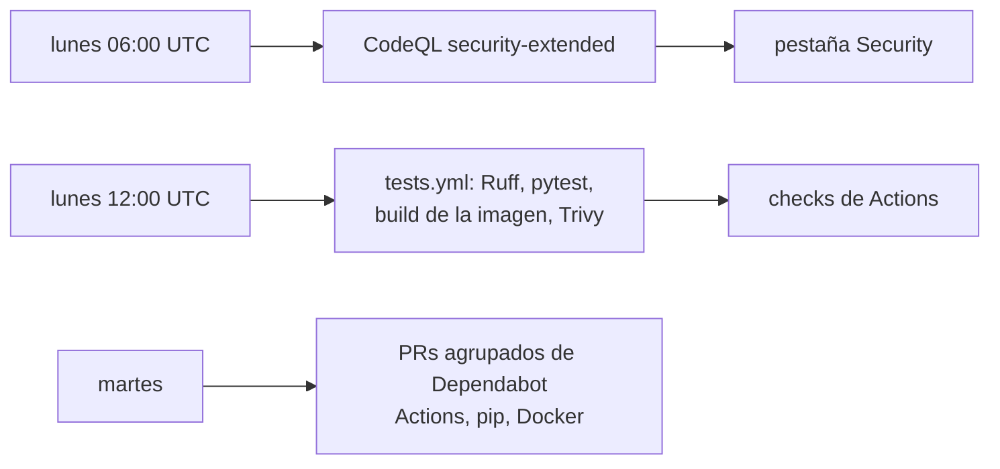

<b>Español</b> · <a href="PRODUCT.md">English</a>

# Dockerized Data Tool como producto

Historias de usuario, flujos y datos. Cómo está hecha cada pieza está en el [README](../README.es.md) y en la [referencia](reference.es.md).

## Para quién es

| Nivel | Quién | Qué necesita |
|---|---|---|
| Día a día | Un analista o ingeniero de datos que recibe exportes en CSV | Ver en segundos qué trae un archivo y atrapar un exporte dañado antes de que siga de largo |
| Supervisión | Quien es dueño de un pipeline o de un job programado | Códigos de salida con los que un script pueda decidir, para que un archivo malo detenga el job en vez de ensuciar un reporte |
| Gerencia | No aplica directamente | No hay tablero ni reporte de negocio; lo más cercano es la revisión de seguridad de abajo |
| Técnico | Quien mantiene la imagen, o un equipo de plataforma o seguridad que tiene que aprobarla | Publicaciones que solo suben lo escaneado, con SBOM y procedencia que se puedan verificar |
| Externo | Google Gemini (solo con `--insights`), GitHub Container Registry y un reclutador que lee el repo | Gemini recibe solo agregados; GHCR sirve la imagen; el reclutador ve la cadena de suministro funcionando |

## Historias de usuario

### Analista (día a día)

#### HU-01 · Ver un resumen rápido de un CSV
**Como** analista **quiero** pasarle un archivo a la herramienta **para** ver su tamaño, columnas y números sin abrir un notebook.
**Criterios de aceptación**
- Dado un CSV legible, la salida empieza con `File: <ruta>`, `Rows: <n>  |  Columns: <n>` y la lista de columnas, y sigue con `Numeric summary:` y el `describe()` de pandas sobre las columnas numéricas.
- Dado un archivo con solo encabezados, imprime "No data rows to summarize." y sale con `0`.
- Dado un archivo sin columnas numéricas, imprime "No numeric columns to summarize." y sale con `0`.
- Sin argumento, usa el `sample.csv` incluido.
**Dónde vive:** `app.py` (`read_csv`, `summarize`)

#### HU-02 · Entender qué falló sin un traceback
**Como** analista **quiero** una sola línea de error clara **para** saber qué arreglar.
**Criterios de aceptación**
- Dada una ruta que no existe, `Error: file not found: <ruta>` por stderr y sale con `2`; una carpeta da `Error: not a file: <ruta>` y sin permisos da `Error: permission denied: <ruta>`.
- Dado un archivo vacío, `Error: the file is empty: <ruta>` y sale con `1`; uno mal formado o binario da `Error: could not parse <ruta> as CSV (...)` y sale con `1`.
**Dónde vive:** `app.py` (`read_csv`, `fail`), `tests/test_app.py`

#### HU-03 · Sacar un contrato de un archivo en el que confío
**Como** analista **quiero** generar el esquema a partir de un exporte que sé que está bien **para** no escribirlo a mano.
**Criterios de aceptación**
- Dado `--infer-schema schema.yaml`, el YAML fija columnas, tipos y si admiten vacíos, e imprime `Schema written: schema.yaml (<n> columns)`.
- Los rangos mínimo/máximo que infiere pandera no se escriben, así que los datos válidos del mes siguiente no fallan.
- Si el destino no se puede escribir, `Error: could not write schema ...` y sale con `2`.
- `--schema` y `--infer-schema` no se pueden usar juntos.
**Dónde vive:** `app.py` (`write_schema`), `tests/test_schema.py`

#### HU-04 · Que me expliquen los números en lenguaje sencillo
**Como** analista **quiero** una explicación opcional con IA **para** compartir una primera lectura con alguien que no lee estadística.
**Criterios de aceptación**
- Dado `--insights` y `GEMINI_API_KEY`, después del resumen imprime `AI insights (gemini-3.6-flash) - only the statistics above were sent, never the rows:` y una explicación de unas 120 palabras como máximo.
- Con `--insights-anonymize`, los nombres de columna se mandan como `col_1`, `col_2`…; usarlo sin `--insights` es un error de argumentos.
- Sin key, sale con `4` y un mensaje que dice dónde sacar una gratis; el resumen ya quedó impreso.
**Dónde vive:** `app.py` (`explain`, `call_gemini`, `stats_payload`), `tests/test_insights.py`

### Dueño del pipeline (supervisión)

#### HU-05 · Detener un job cuando un archivo rompe el contrato
**Como** dueño de un job programado **quiero** que un archivo dañado detenga la corrida **para** que una columna renombrada o texto en una columna numérica nunca lleguen a un reporte.
**Criterios de aceptación**
- Dado `--schema schema.yaml` y un archivo que no lo cumple, no se imprime el resumen, sale una línea `Error:` por problema y el código es `3`.
- Los mensajes son del tipo `missing column 'revenue'`, `unexpected column '...'`, `column 'units': expected int64 values, found 'twelve' (line 3)` o `empty values on`, con máximo 3 ejemplos y "and N more".
- Una celda que falló la validación de tipo no se vuelve a reportar como falla de rango.
- Si el archivo pasa, imprime `Schema: OK (<ruta>)` y luego el resumen.
**Dónde vive:** `app.py` (`check_schema`, `describe_failures`)

#### HU-06 · Distinguir los problemas por código de salida
**Como** dueño de un job **quiero** un código distinto para cada tipo de falla **para** que el script decida si reintenta, avisa o salta el archivo.
**Criterios de aceptación**
- `0` bien, `1` los datos no se pueden leer, `2` la ruta está mal, `3` falló el contrato, `4` falló `--insights` después del resumen.
- `tests/test_app.py` revisa cada código, y el CI además corre el contenedor contra un archivo que no existe y falla si no sale con `2`.
**Dónde vive:** `app.py` (`EXIT_*`), `.github/workflows/tests.yml`

#### HU-07 · Tener claro que ninguna fila sale del equipo
**Como** dueño de datos privados **quiero** saber exactamente qué manda `--insights` **para** poder usarlo con archivos reales.
**Criterios de aceptación**
- Sin `--insights` no hay ninguna llamada de red.
- Con `--insights` solo se mandan conteos de filas y columnas, nombres de columna (salvo si se anonimizan), tipos, conteos de vacíos y la tabla numérica de `describe()`, con tope de 6.000 caracteres. Las columnas de texto no se describen, así que su valor más frecuente nunca sale.
- La key viaja solo en el header `x-goog-api-key` y nunca se imprime, ni siquiera en un error.
**Dónde vive:** `app.py` (`stats_payload`, `call_gemini`)

### Quien la mantiene y revisión de seguridad (técnico)

#### HU-08 · Correr la imagen publicada sin compilar nada
**Como** usuario de la imagen **quiero** hacer `docker pull` y correrla **para** tener la misma herramienta en cualquier máquina.
**Criterios de aceptación**
- `ghcr.io/juanberrio0399/dockerized-data-tool` tiene `linux/amd64` y `linux/arm64` bajo el mismo tag.
- El contenedor corre con UID `10001`, no como root; el CI falla si `id -u` devuelve `0`.
- `latest`, `1`, `1.0`, `1.0.0` salen de tags de Git `vX.Y.Z`; `edge` es el último commit de `main`.
**Dónde vive:** `Dockerfile`, `.github/workflows/publish.yml`

#### HU-09 · Publicar solo lo que se escaneó
**Como** quien la mantiene **quiero** que el registro reciba exactamente la imagen que revisó Trivy **para** que no salga nada sin escanear.
**Criterios de aceptación**
- Cada plataforma compila en un runner nativo (`ubuntu-24.04`, `ubuntu-24.04-arm`) y Trivy tumba el job con cualquier hallazgo CRITICAL o HIGH que tenga arreglo.
- Después de subirla, el workflow vuelve a bajar el digest y falla si no es igual a la imagen escaneada.
- El manifest list se arma solo con los dos digests escaneados, y el workflow verifica que tenga exactamente esos dos.
**Dónde vive:** `.github/workflows/publish.yml`

#### HU-10 · Verificar de dónde salió una imagen
**Como** revisor de seguridad **quiero** procedencia firmada y un SBOM **para** aprobar la imagen sin tener que creerle al README.
**Criterios de aceptación**
- Cada digest por plataforma tiene procedencia SLSA y un SBOM SPDX atestiguados; el digest del índice también tiene procedencia.
- `gh attestation verify --owner juanberrio0399 oci://ghcr.io/juanberrio0399/dockerized-data-tool:latest` pasa.
- No existen credenciales del registro: el workflow entra con su propio `GITHUB_TOKEN`.
**Dónde vive:** `.github/workflows/publish.yml`

#### HU-11 · Atrapar CVE nuevos aunque no haya cambios
**Como** quien la mantiene **quiero** un escaneo semanal **para** que un CVE nuevo en la imagen base aparezca sin esperar a un commit.
**Criterios de aceptación**
- `tests.yml` corre todos los lunes a las 12:00 UTC y en cada push y PR: Ruff, 41 pruebas de pytest, build de la imagen, Trivy, la revisión de no-root y la de códigos de salida.
- CodeQL corre en cada push y PR y los lunes a las 06:00 UTC; Dependabot abre PRs agrupados de Actions, pip y Docker cada martes.
**Dónde vive:** `.github/workflows/tests.yml`, `.github/workflows/codeql.yml`, `.github/dependabot.yml`

## Flujos

### Al correr la herramienta

Toda falla termina en una línea `Error:` por stderr y un código conocido. El resumen se imprime antes de `--insights`, así que una falla de Gemini nunca lo tapa.

### Insights con IA

### Validar un archivo dentro de un job programado

Así lo conectaría en un pipeline; la herramienta en sí no programa nada. Lo importante es que cada código significa una sola cosa, así que el job reacciona sin tener que leer texto.

### Publicación

En un pull request corren el mismo build y el mismo escaneo, pero no se sube nada. Un grupo `concurrency` por rama o tag evita que dos corridas muevan los tags de paso al mismo tiempo.

### Revisiones semanales

Si la corrida del lunes sale en rojo sin commits nuevos, es que la imagen base tiene un CVE nuevo. Volver a correrla casi siempre lo arregla porque el build hace `apt-get upgrade`; si no, hay que mover la base `python:3.14-slim`.

## Información

| Dato | De dónde viene | Dónde se guarda | Quién lo lee | Sensibilidad | Cuánto dura |
|---|---|---|---|---|---|
| El CSV que se analiza | El usuario | Su disco, montado en el contenedor | `app.py`, solo en memoria | La que tenga el archivo (puede ser personal) | No se guarda: no se escribe nada salvo con `--infer-schema` |
| Contrato de esquema (YAML) | `--infer-schema` o el usuario | Donde el usuario lo escriba | `--schema` | Interna (nombres y tipos de columna) | Mientras el usuario lo conserve |
| Estadísticas agregadas | `stats_payload` | Se mandan a Google solo con `--insights` | API de Gemini | Interna; los nombres de columna se pueden ocultar con `--insights-anonymize` | Según los términos de la API de Google |
| `GEMINI_API_KEY` | El usuario | Su entorno, pasada con `-e` | `call_gemini` | Secreta | Nunca se guarda en el repo ni en la imagen |
| Imagen, SBOM, procedencia | `publish.yml` | GHCR y las atestaciones de GitHub | Cualquiera que la baje o la verifique | Pública | Hasta que se borre la versión del paquete |
| Resultados de los escaneos | Trivy, CodeQL | Logs de Actions, pestaña Security | Quien la mantiene | Interna | La retención de logs de GitHub |

## Conexiones

| Sistema | Para qué | Cómo | Si se cae |
|---|---|---|---|
| GitHub Actions | Pruebas, escaneos, build y publicación | `tests.yml`, `publish.yml`, `codeql.yml` | No salen imágenes nuevas; las publicadas siguen funcionando |
| GitHub Container Registry | Aloja la imagen | `docker push` con `GITHUB_TOKEN` | Falla el `docker pull`; compilar en local sigue funcionando |
| Atestaciones de GitHub (Sigstore) | Firmas de procedencia y SBOM | `actions/attest-build-provenance`, `actions/attest-sbom` | La publicación falla antes de poner los tags |
| Trivy | Bloqueo por vulnerabilidades | Action en los dos workflows | Fallan los jobs; no se publica nada |
| API de Google Gemini | Explicación en lenguaje sencillo | HTTPS, header `x-goog-api-key` | `--insights` sale con `4`; todo lo demás funciona |
| Docker Hub (`python:3.14-slim`) | Imagen base | `FROM` en el `Dockerfile` | Fallan los builds; las imágenes publicadas no se afectan |
| [juanberrio0399.github.io](https://github.com/juanberrio0399/juanberrio0399.github.io) | Enlaza el repo desde mi portafolio | Tarjeta de proyecto en el sitio | Aquí no cambia nada |

## Pendiente

- OpenSSF Scorecard ([#47](https://github.com/juanberrio0399/dockerized-data-tool/issues/47)).
- Firma de la imagen sin llaves con Cosign ([#55](https://github.com/juanberrio0399/dockerized-data-tool/issues/55)).
- Lectura por lotes para que un archivo más grande que la memoria no falle ([#56](https://github.com/juanberrio0399/dockerized-data-tool/issues/56)).
- Publicarla como GitHub Action en el Marketplace ([#46](https://github.com/juanberrio0399/dockerized-data-tool/issues/46)).
- Otros formatos (exportar a Parquet con los metadatos del contrato, [#75](https://github.com/juanberrio0399/dockerized-data-tool/issues/75)) y detección de deriva entre snapshots ([#76](https://github.com/juanberrio0399/dockerized-data-tool/issues/76)).
- Un `schema.yaml` de ejemplo en el repo y un CHANGELOG.
- Un aviso temprano de cuando Google retire `GEMINI_MODEL`: hoy solo se nota como un `4` al correrla.
